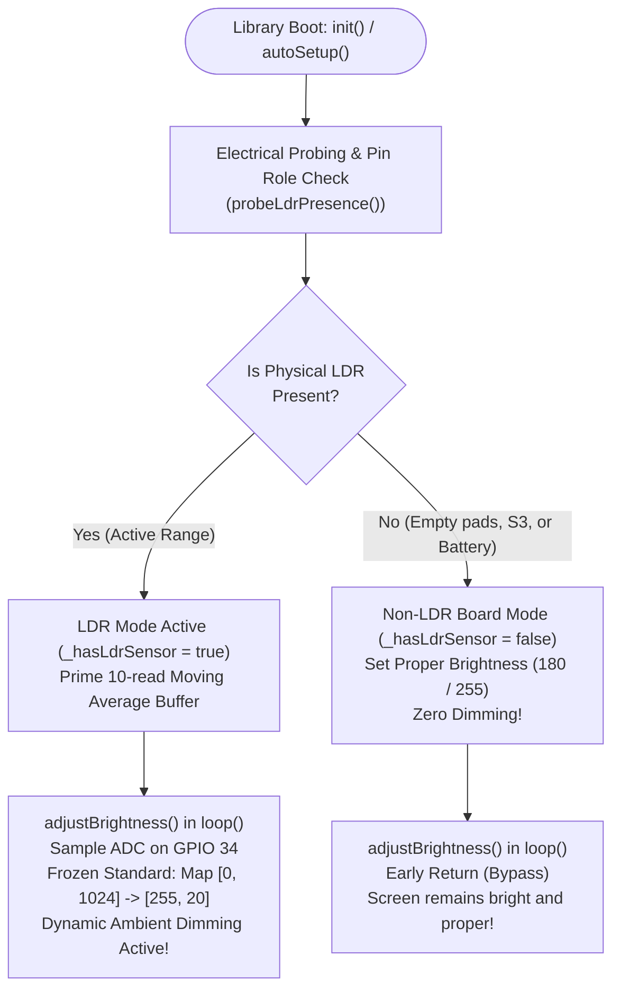

# AMK_CYD Responsive Design Standard & Hardcore GUI Specification
**Author & Maintainer:** Aung Moe Khine (AMK)  
**Standard Version:** 1.0.0 (Mandatory for all `AMK_CYD_Universal_TFT` Sketches & Examples)  
**Scope:** All ESP32 Cheap Yellow Display (CYD) Panels (2.4" to 4.0") and ESP32-S3 Parallel RGB Displays (4.3" to 7.0")  

---

## 1. The Golden Law of Dynamic Display Geometry

> [!IMPORTANT]
> **RULE #1: ZERO HARDCODED SCREEN NUMBERS.**
> Never write literal pixel coordinates for screen width, height, centers, or margins (e.g. `320`, `240`, `480`, `800`, `160`, `120`).
> **ALL dimensions, positions, fonts, and limits MUST be derived at runtime** from library query methods:
> * Screen Width: `int sw = tft.width();`
> * Screen Height: `int sh = tft.height();`
> * Horizontal Center: `int cx = sw / 2;`
> * Vertical Center: `int cy = sh / 2;`
> * Native Panel Dimensions: `display.nativeWidth()`, `display.nativeHeight()`
> * Panel Diagonal Size: `display.diagonalTenths()` (e.g., `28` = 2.8", `35` = 3.5", `70` = 7.0")
> * Hardware Terminal Matrix: `term.columns()`, `term.rows()`

A sketch written using this standard can be flashed into a **2.4" 240x320 CYD**, a **3.5" 320x480 CYD**, or a **7.0" 800x480 S3 RGB display** without changing a single line of code, rendering pixel-perfect, balanced, unclipped layouts every time.

---

## 2. Hardware Resolution Tiers & Characteristics

The entire ESP32 display ecosystem supported by `AMK_CYD_Universal_TFT` categorizes into three standard hardware tiers:

```mermaid
flowchart TD
    subgraph "Tier S: Compact QVGA"
        T1["2.4\" (ESP32-024)<br>2.8\" (2432S028R / ELEGOO / 32E)<br>3.2\" (2432S032 / 32E)"]
        R1["Resolution: 240x320 (Portrait) / 320x240 (Landscape)<br>Aspect: 4:3 / 3:4<br>Density: ~140-166 PPI"]
    end

    subgraph "Tier M: Mid HVGA"
        T2["3.5\" (ESP32-035 / 3248S035 / 32E)<br>4.0\" (ESP32-32E 4.0\")"]
        R2["Resolution: 320x480 (Portrait) / 480x320 (Landscape)<br>Aspect: 3:2 / 2:3 (1.33x Width / 1.5x Height of Tier S)<br>Density: ~165-150 PPI"]
    end

    subgraph "Tier L: Widescreen WVGA"
        T3["4.3\" / 5.0\" / 7.0\" ESP32-S3 Parallel RGB<br>(Waveshare / Sunton / Guition)"]
        R3["Resolution: 800x480 (Landscape) / 480x800 (Portrait)<br>Aspect: 5:3 Widescreen (2.5x Width / 2.0x Height of Tier S)<br>Density: ~133-217 PPI"]
    end
```

### Detection Macro Logic in Sketches:
```cpp
// Determine Tier dynamically in sketch setup/rendering:
const int sw = tft.width();
const int sh = tft.height();

const bool isTierL = (sw >= 800 || sh >= 800); // 4.3" - 7.0" (800x480)
const bool isTierM = (!isTierL && (sw >= 480 || sh >= 480)); // 3.5" - 4.0" (480x320)
const bool isTierS = (!isTierL && !isTierM); // 2.4" - 3.2" (320x240)
```

---

## 3. Master Typography & Font Pairing Matrix

Typography must be sized proportionally to avoid edge clipping on Tier S while preventing tiny, unreadable text on Tier M and Tier L.

| UI Component | Tier S (320x240 / 240x320) | Tier M (480x320 / 320x480) | Tier L (800x480 / 480x800) | Alignment Datum | Safety Fallback Formula |
|:---|:---|:---|:---|:---:|:---|
| **Header Title** | `&FreeSansBold9pt7b`<br>(Font Height ~18px) | `&FreeSansBold12pt7b`<br>(Font Height ~24px) | `&FreeSansBold18pt7b`<br>(Font Height ~34px) | `MC_DATUM` or `ML_DATUM` | If `tft.textWidth(title) > sw - 24`, fallback to `FreeSans9pt7b` or `Font 2`. |
| **Header Subtitle / Tag** | `Font 1` (GLCD 5x7, Size 1) | `Font 1` (Size 1) or `Font 2` | `Font 2` or `&FreeSans9pt7b` | `TC_DATUM` or `MC_DATUM` | Must maintain $\ge 4\text{px}$ vertical padding. |
| **Card Category Label** | `Font 1` (Size 1, Muted Gray) | `Font 1` (Size 1) or `Font 2` | `Font 2` (Size 1) | `TC_DATUM` | Placed at `y + 3px` from card top. |
| **Hero Telemetry Value** | `&FreeSans9pt7b` or `&FreeSansBold9pt7b` | `&FreeSans12pt7b` or `&FreeSansBold12pt7b` | `&FreeSans18pt7b` or `&FreeSans24pt7b` | `MC_DATUM` | If `tft.textWidth(val) > cardW - 8`, fallback to `Font 2`. |
| **Secondary Value / Units** | `Font 1` (Size 1) | `Font 1` (Size 1) or `Font 2` | `Font 2` or `&FreeSans9pt7b` | `BC_DATUM` | Placed at `y + cardH - 4px`. |
| **Status Badge / Pill** | `Font 1` (Pill: $84 \times 18\text{px}$) | `Font 1` (Pill: $96 \times 22\text{px}$) | `Font 2` (Pill: $120 \times 26\text{px}$) | `MC_DATUM` | Symmetrical rounded rectangle (`radius = 4`). |
| **Touch Buttons (`TFT_eSPI_Button`)**| Text Size `1` with FreeFont or Size `2` GLCD | Text Size `2` (or `FreeSans9pt7b`) | Text Size `2` or `3` | `MC_DATUM` | Button Height: `(sh >= 480 ? 60 : (sh >= 320 ? 50 : 38))`. |
| **Footer Status Strip** | `Font 1` (Size 1, Centered) | `Font 1` (Size 1) | `Font 2` (Size 1) | `MC_DATUM` | Strip Height: `(sh >= 480 ? 30 : (sh >= 320 ? 24 : 18))`. |
| **Hardware Terminal Matrix** | Fixed $16 \times 16\text{px}$ cell ($15 \times 20$ chars) | Fixed $16 \times 16\text{px}$ cell ($20 \times 30$ chars) | N/A (SPI Panel Hardware Scrolling) | Cell Coordinates | String lengths $\le 15$ chars (Tier S), $\le 20$ chars (Tier M). |
| **LVGL Montserrat Engine** | `montserrat_14` / `16` | `montserrat_18` / `20` / `22` | `montserrat_24` / `28` / `32` | LVGL Native Flex | Mapped via `gScale = min(shortSide/240.0, longSide/320.0)`. |

---

## 4. Standard Mathematical Layout Equations

To guarantee symmetrical margins and prevent any component from touching panel edges or overlapping, always use these exact mathematical layout equations:

### A. Symmetrical Multi-Column Calculation with Remainder Balancing
When distributing $N$ cards or buttons across the screen width:

```cpp
// 1. Determine dynamic gap and target columns
const int gap = (sw >= 800) ? 12 : ((sw >= 480) ? 8 : 4);
const int numCols = 3; // e.g. 3 cards or buttons

// 2. Compute total available width subtracting all inter-item gaps
const int totalAvailableW = sw - (gap * (numCols + 1));
const int colW = totalAvailableW / numCols;
const int remainder = totalAvailableW % numCols;

// 3. Balance remainder equally across left and right margins
const int sideMargin = gap + (remainder / 2);

// 4. Position each card with mathematical precision:
for (int i = 0; i < numCols; i++) {
    int cardX = sideMargin + i * (colW + gap);
    // Draw card at cardX with width colW...
}
```

### B. Vertical Rhythm & Card Height Hierarchy
Heights scale dynamically based on total screen height (`sh`):

```cpp
// Header Bar Height
const int headerH = (sh >= 480) ? 44 : ((sh >= 320) ? 32 : 26);

// Primary Metric Card Height
const int cardH = (sh >= 480) ? 120 : ((sh >= 320) ? 90 : 76);

// Interactive Button Height
const int btnH = (sh >= 480) ? 60 : ((sh >= 320) ? 50 : 38);

// Bottom Footer Bar Height
const int footerH = (sh >= 480) ? 30 : ((sh >= 320) ? 24 : 18);

// Card Interior Vertical Anchor Points (Golden Percentages)
const int l1_Y = cardY + (cardH * 22 / 100); // 22% Down: Subtitle / Tag
const int l2_Y = cardY + (cardH * 50 / 100); // 50% Down: Center Hero Metric
const int l3_Y = cardY + (cardH * 78 / 100); // 78% Down: Secondary Unit / Detail
```

---

## 5. Universal Card Drawing & Text Fallback Template

Every telemetry card or metric box in any future sketch should follow this standard implementation pattern:

```cpp
void drawResponsiveCard(int x, int y, int w, int h, 
                        const char* category, const char* value, 
                        const char* unit, uint16_t valueColor) {
    // 1. Background & Border
    tft.fillRoundRect(x, y, w, h, 4, 0x10A2); // Charcoal Slate fill
    tft.drawRoundRect(x, y, w, h, 4, 0x2965); // Subtle Border

    // 2. Top Category Tag (Font 1, Muted Gray, Always fits)
    tft.setFreeFont(nullptr);
    tft.setTextFont(1);
    tft.setTextSize(1);
    tft.setTextColor(0x9CD3, 0x10A2); // Cool Silver Gray
    tft.setTextDatum(TC_DATUM);
    tft.drawString(category, x + (w / 2), y + 4);

    // 3. Center Hero Value with Width Guard & Graceful Fallback
    const int valY = y + (h * 50 / 100);
    tft.setTextColor(valueColor, 0x10A2);
    tft.setTextDatum(MC_DATUM);

    // Check screen tier to pick appropriate FreeFont
    if (tft.width() >= 480) {
        tft.setFreeFont(&FreeSansBold12pt7b);
    } else {
        tft.setFreeFont(&FreeSansBold9pt7b);
    }

    // Boundary Validation: Does the string fit the card?
    if (tft.textWidth(value) <= w - 8) {
        tft.drawString(value, x + (w / 2), valY);
    } else {
        // Fallback to compact GLCD Font 2 if value is unusually long
        tft.setFreeFont(nullptr);
        tft.drawString(value, x + (w / 2), valY, 2);
    }

    // 4. Bottom Detail / Unit Tag
    if (unit && unit[0] != '\0') {
        tft.setFreeFont(nullptr);
        tft.setTextFont(1);
        tft.setTextSize(1);
        tft.setTextColor(0x9CD3, 0x10A2);
        tft.setTextDatum(BC_DATUM);
        tft.drawString(unit, x + (w / 2), y + h - 4);
    }

    // 5. Always leave FreeFont in clean state
    tft.setFreeFont(nullptr);
}
```

---

## 6. Hardware Text Terminal Responsive Standard (`AMK_Terminal.h`)

Because the hardware text terminal operates directly on the panel's physical vertical scrolling registers (`VSCRDEF`/`VSCRSADD`), it operates along the panel's native long axis (**Rotation 0 or 2**):

* **240x320 Panels (Tier S):** Width = 240px. At $16\text{px}$ cell width = **15 Columns $\times$ 20 Rows**.
* **320x480 Panels (Tier M):** Width = 320px. At $16\text{px}$ cell width = **20 Columns $\times$ 30 Rows**.

### Mandatory Terminal Formatting Helpers:
Sketches using `AMK_Terminal` must **NEVER** print hardcoded 30-character strings (which wrap unpredictably). Always use these two dynamic helpers:

```cpp
// 1. Dynamic Divider Line (matches exact column count)
void printDivider(char c, uint16_t fg, uint16_t bg = CYDR_BLACK) {
    term.setTextColor(fg, bg);
    const int cols = term.columns();
    for (int i = 0; i < cols; i++) term.print(c);
    term.println();
}

// 2. Dynamic Centered Text Line (centers within available columns)
void printCentered(const char* text, uint16_t fg, uint16_t bg = CYDR_BLACK) {
    term.setTextColor(fg, bg);
    const int cols = term.columns();
    const int len = (int)strlen(text);
    if (len >= cols) {
        for (int i = 0; i < cols; i++) term.print(text[i]);
    } else {
        const int pad = (cols - len) / 2;
        for (int i = 0; i < pad; i++) term.print(' ');
        term.print(text);
    }
    term.println();
}

// 3. Single-Line Telemetry Stream (Zero Wrapping)
void printTelemetry(unsigned long count, uint32_t heapK, float batV, bool isBat) {
    const int cols = term.columns();
    term.setTextColor(CYDR_GREEN, CYDR_BLACK);
    if (cols >= 20) {
        // Tier M (20 columns): Exactly 19-20 chars on 1 line
        term.printf("[%04lu] %3luK ", count, (unsigned long)heapK);
        if (isBat) {
            term.setTextColor(CYDR_CYAN, CYDR_BLACK);
            term.printf("Bat:%.2fV\n", batV);
        } else {
            term.setTextColor(CYDR_WHITE, CYDR_BLACK);
            term.printf("Up:%lus\n", millis() / 1000);
        }
    } else {
        // Tier S (15 columns): Exactly 13-14 chars on 1 line
        term.printf("#%lu %luK ", count, (unsigned long)heapK);
        if (isBat) {
            term.setTextColor(CYDR_CYAN, CYDR_BLACK);
            term.printf("B:%.1fV\n", batV);
        } else {
            term.setTextColor(CYDR_WHITE, CYDR_BLACK);
            term.printf("U:%lus\n", millis() / 1000);
        }
    }
}
```

---

## 7. LVGL Dynamic GUI Scaler (`gScale` Architecture)

For advanced GUI applications (such as `MP3Player` and `LVGL_QuickStart`), all widget positions, padding, radii, and fonts are computed from a master design base ($240 \times 320$) via `gScale`:

```cpp
static float gScale = 1.0f;

static void compute_scale() {
    lv_display_t *disp = lv_display_get_default();
    int w = lv_display_get_horizontal_resolution(disp);
    int h = lv_display_get_vertical_resolution(disp);
    int shortSide = w < h ? w : h, longSide = w < h ? h : w;
    float a = shortSide / 240.0f, b = longSide / 320.0f;
    gScale = (a < b) ? a : b; // 1.0 on 240x320; 1.33 on 320x480; 2.0 on 800x480
}

static inline int32_t px(int designPx) {
    return (int32_t)lroundf(designPx * gScale);
}

// Selects the closest compiled Montserrat font to (designPx * gScale)
static const lv_font_t *font(int designPx) {
    static const struct { int sz; const lv_font_t *f; } fonts[] = {
        {14, &lv_font_montserrat_14}, {16, &lv_font_montserrat_16},
        {18, &lv_font_montserrat_18}, {20, &lv_font_montserrat_20},
        {22, &lv_font_montserrat_22}, {24, &lv_font_montserrat_24},
        {28, &lv_font_montserrat_28},
    };
    float want = designPx * gScale;
    const lv_font_t *best = fonts[0].f;
    float bestErr = 1e9f;
    for (const auto &e : fonts) {
        float err = fabsf(e.sz - want);
        if (err < bestErr) { bestErr = err; best = e.f; }
    }
    return best;
}
```

---

## 8. The 10 Inviolable Rules of AMK GUI Crafting (Checklist)

1. **Rule 1 (Zero Hardcoded Pixels):** Always fetch `tft.width()` and `tft.height()`. Never hardcode 320, 240, 480, or 800.
2. **Rule 2 (Always Set Text Datum):** Explicitly declare `tft.setTextDatum(...)` before every single `drawString()` call.
3. **Rule 3 (Width Boundary Verification):** Always test `tft.textWidth(str) <= cardW - margin` before drawing large FreeFonts, with a fallback to `Font 2` or `Font 1`.
4. **Rule 4 (TFT_eSPI_Button State Reset):** Calling `btn.drawButton()` leaves `textSize` at 2. Always execute `tft.setTextSize(1)` and `tft.setFreeFont(nullptr)` immediately after button drawing.
5. **Rule 5 (Symmetrical Gap Balancing):** Inter-card gaps must distribute remainder pixels (`remainder / 2`) into left and right margins for pixel-perfect screen centering.
6. **Rule 6 (Frozen Color Order):** Never alter MADCTL color tables. Always keep `tft.setSwapBytes(true)` for 16-bit RGB565 sprites and images (RULE[user_global]).
7. **Rule 7 (Dynamic Backlight & 1-Line Setup):** Always initialize with `tft.autoSetup(rot)` and query `tft.backlightPin()`. Never hardcode GPIO 21 or 27.
8. **Rule 8 (Loop Auto-Dimming & Non-LDR Safe Fallback):** Always place `tft.adjustBrightness()` at the top of `void loop()`. The library automatically probes physical LDR presence: on LDR-equipped boards, it dynamically auto-dims on ambient room light changes using the hardcore frozen mapping formula `map(average, 0, 1024, 255, 20)`; on boards lacking an LDR (or battery divider boards), it automatically sets and maintains a proper bright backlight (`PROPER_NON_LDR_BACKLIGHT = 180` / 255) and prevents auto-dimming down to pitch black.
9. **Rule 9 (Pop-Free Audio Sequencing):** Always use `tft.enableAudio(true)` and `tft.playBeep(freq, ms)` rather than manual GPIO 4 or DAC manipulation.
10. **Rule 10 (Terminal Column Awareness):** All terminal headers, dividers, and telemetry streams must format dynamically to `term.columns()`, never exceeding 15 chars (Tier S) or 20 chars (Tier M).

---

## 9. Intelligent LDR Auto-Detection & Safe Backlight Standard

> [!IMPORTANT]
> **HARDCORE PERMANENT RULE: NEVER ALTER THE LDR MAPPING VALUE.**  
> The ambient lux mapping formula is strictly and permanently frozen:  
> `int target = constrain(map(average, 0, 1024, 255, 20), 20, 255);`  
> * Do NOT alter the `0 - 1024` ADC input range.  
> * Do NOT alter the `255 - 20` output PWM range.  
> * Do NOT force a fixed brightness on every board: boards with an LDR MUST dynamically auto-dim!  
> * For boards lacking an LDR (e.g. ELEGOO single USB-C, battery boards, S3), auto-detect and set proper comfortable brightness (`PROPER_NON_LDR_BACKLIGHT = 180`), completely bypassing auto-dimming down to 20.



### Standards Summary:
1. **Never Assume LDR is Present:** Many CYD boards (e.g. ELEGOO single USB-C 2.8", ESP32-32E battery boards, S3 boards) do not have a photoresistor soldered to GPIO 34.
2. **Library Query API:** Use `tft.hasLdrSensor()` to check if ambient light sensing is available.
3. **Hardcore Frozen Mapping:** For boards with an LDR, ambient lux mapping follows `constrain(map(average, 0, 1024, 255, 20), 20, 255)`. Never change these mapping numbers.
4. **Proper Non-LDR Backlight:** Only boards without an LDR are set to proper comfortable brightness (`PROPER_NON_LDR_BACKLIGHT = 180`), while LDR-equipped boards remain fully dynamic.
