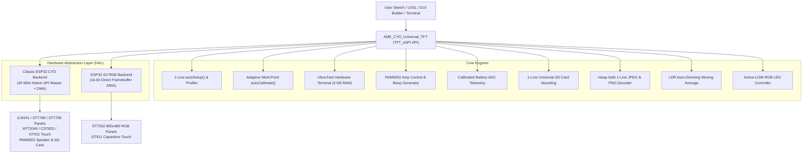

# AMK_CYD_Universal_TFT (v1.8.1) — Comprehensive Developer Guide & Technical Datasheet
**Author & Maintainer:** Aung Moe Khine (AMK)  
**Target Hardware:** ESP32 Cheap Yellow Display (CYD) family (2.4" to 4.0") & ESP32-S3 Parallel RGB Displays (4.3" to 7.0")  
**Frameworks:** Arduino IDE 1.8.x / 2.x, PlatformIO, Visual Studio Code  
**License:** MIT  

---

## 1. Executive Summary & Value Proposition

The **`AMK_CYD_Universal_TFT`** library is a high-performance, drop-in universal display, touch, audio, and hardware abstraction driver designed to eliminate the severe hardware fragmentation of the ESP32 Cheap Yellow Display (CYD) ecosystem and ESP32-S3 Parallel RGB displays.

Standard libraries (like generic `TFT_eSPI`) require developers to manually hunt down GPIO pinouts, hack `User_Setup.h`, and recompile whenever switching board models or revisions. **AMK_CYD_Universal_TFT solves this automatically at runtime:**
* **Zero Configuration Required:** Probes panels, touch controllers, backlight pins, battery dividers, and audio amplifier shutdown pins dynamically at boot.
* **100% TFT_eSPI Drop-In Compatible:** Existing code written for Bodmer's `TFT_eSPI`, `TFT_eSprite`, and `TFT_eSPI_Button` works seamlessly without code rewrites.
* **35 to 60+ FPS DMA Performance:** Native ESP-IDF 40 MHz SPI driver with non-blocking DMA chunk burst blitting.
* **Ultra-Fast Hardware Text Terminal (`AMK_Terminal.h`):** 5 KB RAM lightweight companion with panel hardware vertical scrolling for telemetry and logging.
* **Universal Single Binary Portability:** Compile one sketch and run it across 17+ hardware variants spanning 2.4" to 7.0" screens.

---

## 2. Complete Supported Hardware Matrix

The library automatically identifies and configures the following hardware architectures at runtime:

### A. Classic ESP32 CYD Family (Resistive & Capacitive)

| Board Model / Form Factor | Screen Size | Resolution | Display IC | Touch Controller & Bus | Backlight Pin | RGB LED Pins | Battery / LDR Pin | PAM8302 Amp Pin |
|:---|:---:|:---:|:---:|:---:|:---:|:---:|:---:|:---:|
| **ESP32-2432S028R** (Dual-USB: Type-C + Micro-USB) | 2.8" | 240x320 | ST7789 / ILI9341 | XPT2046 (Dedicated bit-bang) | GPIO 21 | R:4, G:16, B:17 | LDR: 34 | Hardwired (GND) |
| **ESP32-2432S028** (Single USB-C, ELEGOO) | 2.8" | 240x320 | ILI9341 | XPT2046 (Dedicated bit-bang) | GPIO 21 | R:4, G:16, B:17 | — | Hardwired (GND) |
| **ESP32-2432S028C** (Capacitive Touch) | 2.8" | 240x320 | ST7789 / ILI9341 | CST820 (I2C SDA:33, SCL:32) | GPIO 21 | R:4, G:16, B:17 | LDR: 34 | Hardwired (GND) |
| **ESP32-32E 2.8"** (USB-C) | 2.8" | 240x320 | ST7789 / ILI9341 | XPT2046 (Dedicated bit-bang) | GPIO 21 | R:22, G:16, B:17 | Bat: 34 | GPIO 4 (Active-LOW) |
| **ESP32-32E 3.2"** (USB-C) | 3.2" | 240x320 | ST7789 | XPT2046 (Shared HSPI Bus) | GPIO 27 | R:22, G:16, B:17 | Bat: 34 | GPIO 4 (Active-LOW) |
| **ESP32-2432S032** (Resistive) | 3.2" | 240x320 | ST7789 | XPT2046 (Shared HSPI Bus) | GPIO 27 | R:4, G:16, B:17 | LDR: 34 | Hardwired (GND) |
| **ESP32-2432S032C** (Capacitive) | 3.2" | 240x320 | ST7789 | GT911 (I2C SDA:33, SCL:32) | GPIO 27 | R:4, G:16, B:17 | LDR: 34 | Hardwired (GND) |
| **ESP32-024 / 2432S024C** | 2.4" | 240x320 | ST7789 / ILI9341 | XPT2046 / CST820 (Swapped ADC) | GPIO 27 | R:4, G:17, B:16 | Bat: 34 | Hardwired (GND) |
| **ESP32-035 / 3248S035** | 3.5" | 320x480 | ST7796 | XPT2046 / GT911 (Shared HSPI) | GPIO 27 | R:4, G:17, B:16 | LDR: 34 | Hardwired (GND) |
| **ESP32-32E 3.5" / 4.0"** | 3.5" / 4.0" | 320x480 | ST7796 | XPT2046 (Shared HSPI Bus) | GPIO 27 | R:22, G:16, B:17 | Bat: 34 | GPIO 4 (Active-LOW) |
| **Guition JC2432W328** | 2.8" | 240x320 | ST7789 | CST820 (Capacitive) | GPIO 21 | R:4, G:16, B:17 | LDR: 34 | Hardwired (GND) |
| **VIEWE UEDX24320028E** | 2.8" | 240x320 | ST7789 IPS | CHSC6540 (I2C SDA:1, SCL:3) | GPIO 13 | — | — | — |
| **ES3C28P 2.8" (ESP32-S3)** | 2.8" | 240x320 | ILI9341V IPS | FT6336 (I2C SDA:16, SCL:15) | GPIO 45 | RGB: 42 | — | ES8311 Codec |

### B. ESP32-S3 Parallel RGB Boards (Sunton & Waveshare)

| Board Family | Screen Size | Resolution | Display IC | Touch Controller | Backlight Control | I2C Bus Pins |
|:---|:---:|:---:|:---:|:---:|:---:|:---:|
| **Waveshare ESP32-S3-Touch-LCD** | 4.3", 5.0", 7.0" | 800x480 | ST7262 (16-bit RGB) | GT911 Capacitive | CH422G I/O Expander (IO2) | SDA: 8, SCL: 9 |
| **Sunton ESP32-8048S Series** (043/050/070) | 4.3", 5.0", 7.0" | 800x480 | ST7262 (16-bit RGB) | GT911 Capacitive | Direct GPIO 2 (8-bit LEDC PWM) | SDA: 19, SCL: 20 |
| **Guition JC8048W550C** | 5.0" | 800x480 | ST7262 (16-bit RGB) | GT911 Capacitive | Direct GPIO 2 (8-bit LEDC PWM) | SDA: 19, SCL: 20 |
| **Elecrow CrowPanel Advance S3** | 2.8" / 5.0" | 240x320 / 800x480 | ST7789 / ST7262 | FT6336U / GT911 | Direct GPIO 38 PWM | SDA: 15, SCL: 16 |

### C. Custom Hardware & DIY Setups (via AMK_User_Setup.h) [NEW in v1.7.0]

| Target Architecture | Display Controllers | Bus Interface | Pin Customization Mechanism | Features Retained |
|:---|:---:|:---:|:---|:---|
| **ESP32 / ESP32-S3 / Custom Boards** | ILI9341, ST7789, ST7796 | High-Speed SPI (FSPI/HSPI) | Project-local or library `AMK_User_Setup.h` | Sprites, FreeFonts, Touch Calibration, LDR Auto-Dimming |

---

## 3. Core Architectural Highlights



### 1. 40 MHz Native ESP-IDF SPI Master Engine
* Completely bypasses generic Arduino `SPI.h` overhead.
* Uses native ESP-IDF `spi_master` with **Hardware Chip Select (`devcfg.spics_io_num`)** and **Pre-transaction ISR callback (`devcfg.pre_cb`)**, reducing D/C and CS switching overhead to zero.
* Runs at **40 MHz default** for maximum stable panel throughput. Sketches can dynamically reconfigure speed via `tft.setSpiClock(hz)` or save permanent clock overrides to NVS.

### 2. Chunk-of-Data DMA Burst Transfer
* Bounding address window is set **only once** per frame or sprite (`_setAddrWindow(x1, y1, x2, y2)`).
* Entire graphics chunks (up to full screen) are pushed in single burst DMA descriptors, completely eliminating screen tearing, stacking, and double-drawing artifacts.
* Asynchronous queuing (`spi_device_queue_trans`) allows the ESP32 CPU core to calculate the next frame or process network requests in parallel while DMA hardware drives the display.

### 3. Dual-Touch Controller Engine with Bus Contention Protection
* Probes I2C addresses `0x5D`/`0x14` (GT911) and `0x15` (CST820) at startup.
* If capacitive touch is found, routes touch coordinates seamlessly; if not found, immediately falls back to high-speed SPI XPT2046 resistive touch.
* Includes `cydr_touchI2cLock` to prevent SPI display readbacks from colliding with I2C touch lines on boards sharing GPIO 33.

---

## 4. Key Features Breakdown (v1.6.6)

### 💻 1. Ultra-Fast Hardware Text Terminal (`AMK_Terminal.h`) [NEW in v1.6.6]
* **Tiny 5 KB RAM Overhead:** Does not buffer full-screen pixel bitmaps. Operates strictly within a 5 KB character matrix.
* **Panel Hardware Vertical Scrolling:** Uses panel driver commands (`VSCRDEF` / `VSCRSADD`) on ILI9341, ST7789, and ST7796. Text scrolls instantly without CPU pixel copying.
* **Full Typography & ANSI Colors:** Supports UTF-8 glyphs, box-drawing characters, ANSI color escape codes (`CYDR_GREEN`, `CYDR_YELLOW`), and LVGL symbols.
* **Character-Cell Touch Detection:** `term.pollTouch(col, row)` reports touch directly mapped to character grid cells for instantaneous touch buttons.

```cpp
#include <AMK_CYD_Universal_TFT.h>

AMK_CYD_Terminal term;

void setup() {
    tft.autoSetup(0); // Terminal operates along native panel axis (rotation 0 or 2)
    term.begin(tft);
    term.println(CYDR_GREEN "AMK Terminal Ready!" CYDR_RESET);
}

void loop() {
    uint8_t c, r;
    if (term.pollTouch(c, r)) {
        term.printf("Touch at Col: %u, Row: %u\n", c, r);
        tft.playBeep(2400, 40); // Click sound feedback
    }
}
```

### 🔊 2. Onboard Audio & PAM8302 Amp Control (`tft.enableAudio()`, `tft.playBeep()`) [NEW in v1.6.6]
* **Dynamic Amp Pin Routing:** Boards with PAM8302 active-LOW shutdown route to GPIO 4 (e.g. ESP32-32E USB-C). Classic boards wire shutdown to GND (always on) and use GPIO 4 for Red LED. The library identifies this dynamically via `tft.audioAmpPin()` to prevent LED thrashing.
* **Pop-Free Ramp Sequencing:** Parks the 8-bit DAC at mid-scale (128) and allows coupling capacitors to settle before pulling enable LOW, eliminating turn-on thumps.
* **1-Line Tone Generation:**
```cpp
tft.playBeep(2000, 100); // 2000 Hz beep for 100 ms with auto-mute idle
```

### 🔋 3. Calibrated Battery ADC Telemetry [NEW in v1.6.6]
* Connects to GPIO 34 via 1:1 voltage divider ($V_{bat} = V_{adc} \times 2$).
* Reads factory eFuse-calibrated millivolts via `analogReadMilliVolts(34)`, bypassing raw ADC non-linearities.
* Built-in percentage calculator (`tft.getBatteryPercentage()`) with Li-ion discharge curve mapping:
```cpp
if (tft.isBatteryPowered()) {
    float volts = tft.getBatteryVoltage();
    uint8_t pct = tft.getBatteryPercentage();
    Serial.printf("Battery: %.2f V (%u%%)\n", volts, pct);
}
```

### 💾 4. 1-Line Standard SD Card Mounting (`tft.initSD()`) [NEW in v1.6.6]
* Mounts the onboard TF / microSD slot on universal VSPI lines (**CS: 5, SCK: 18, MISO: 19, MOSI: 23**) across all CYD models.
* Configures 20 MHz high-speed mode for streaming MP3 audio with automatic 4 MHz fallback:
```cpp
if (tft.initSD()) {
    Serial.println("SD Card mounted successfully!");
}
```

### 🪄 5. Master 1-Line Hardware Auto-Setup
Replaces 30 to 50 lines of duplicate boilerplate across all sketches with a single call:
```cpp
#include <AMK_CYD_Universal_TFT.h>

TFT_eSPI tft;

void setup() {
    Serial.begin(115200);
    // 1-Line auto-detects panel, touch bus, backlight pin, LED pins, and sets rotation:
    tft.autoSetup(3); // 3 = Landscape USB left
}
```

### 🎯 6. Adaptive Multi-Point Statistical Touch Calibration
* **Dynamic Grid:** Scales from $4 \times 3$ (12 points) on 240x320 up to $6 \times 5$ (30 points) on 320x480 panels.
* **Statistical Filtering:** Jitter noise rejection (`JITTER_RAW = 130`, `MIN_SAMPLES = 8`).
* **2D Linear Regression:** Computes sub-pixel affine transformations with RMS error verification (`ACCEPT_RMS <= 6.0 px`).
* **NVS Flash Persistence:** Saves calibration permanently; subsequent boots calibrate in `< 1 ms`.
* **Capacitive Touch Bypass:** Detects capacitive panels and skips calibration instantly with 0 ms overhead.
* **BOOT Button Override:** Holding the BOOT button (GPIO 0) at boot forces a fresh recalibration.

```cpp
tft.autoCalibrate(); // Loads from NVS if present, runs interactive if unset
tft.autoCalibrate(/*force=*/true); // Force recalibration
```

### 🖼️ 7. 1-Line Heap-Safe JPEG & PNG Decoder (`AMK_Image_Decoder.h`)
* Render images directly from **LittleFS, SPIFFS, SD cards, SD_MMC**, or Flash arrays:
  ```cpp
  tft.drawJpgFile(LittleFS, "/wallpaper.jpg", 0, 0);
  tft.drawPngFile(LittleFS, "/icon.png", 50, 50);
  tft.drawJpg(my_jpg_array, sizeof(my_jpg_array), 0, 0);
  tft.drawPng(my_png_array, sizeof(my_png_array), 10, 10);
  ```
* **Heap-Safe Architecture:** The ~42 KB `PNG` structure is allocated on the Heap via `new (std::nothrow) PNG()`, completely eliminating FreeRTOS 8 KB task stack overflows and watchdog reboot loops (`rst:0x8 (TG1WDT_SYS_RESET)`).
* **Zero Full-Frame RAM Buffering:** Streams MCU blocks and scanlines directly into `pushImage()`.
* **MCU Scanline Memory Packing:** Eliminates jagged edge distortion for JPEGs whose dimensions are not divisible by 16.

### ☀️ 8. Ambient Light Auto-Dimming & Intelligent Sensor Probing
* **Automatic Sensor Probing (`tft.probeLdrPresence()`):** Automatically determines whether an LDR photoresistor is physically connected to GPIO 34 at boot and during runtime.
* **Non-LDR Board Protection:** Boards without an LDR (e.g. ELEGOO single USB-C 2.8", battery divider boards, ESP32-S3) automatically set proper comfortable brightness (`PROPER_NON_LDR_BACKLIGHT = 180` / 255) and bypass auto-dimming down to 20.
* **Hardcore Frozen Mapping (0-1024):** On LDR-equipped boards, backlight dynamically auto-dims on ambient lux using the permanent frozen formula: `constrain(map(average, 0, 1024, 255, 20), 20, 255)` with 4-unit hysteresis deadband.
* **API Controls:** `tft.hasLdrSensor()` and `tft.getProperNonLdrBacklight()` allow sketches to query sensor presence and proper backlight level.
* Seamless 1-line call in `loop()`:
  ```cpp
  void loop() {
      tft.adjustBrightness(); // Adjusts PWM duty cycle dynamically
  }
  ```

### 💡 9. Universal Active-LOW RGB LED Control
Handles pin variations (GPIO 4 vs GPIO 22 for Red; GPIO 16/17 swap) automatically:
```cpp
tft.setRgbLed(true, false, false); // Red
tft.setRgbLed(false, true, false); // Green
tft.setRgbLed(false, false, true); // Blue
tft.turnLedOff();                  // Off
tft.flashLed(0, 1, 0, 100);        // Flash green for 100 ms
tft.flashLedSequence(50);          // Rapid RGB cycle diagnostic
```

---

## 5. Master API Quick-Reference

| Category | Method | Description |
|:---|:---|:---|
| **Setup & Probing** | `tft.autoSetup(rot, autoCal, report)` | Universal 1-line boot setup, probing, backlight, and calibration. |
| | `tft.printHardwareReport()` | Dumps full board, panel, resolution, touch, and pin telemetry to Serial. |
| | `tft.getBoardProfile()` | Returns const pointer to `AMK_BoardProfile` struct. |
| | `tft.backlightPin()` | Returns auto-detected backlight GPIO pin (21, 27, 2, or -1). |
| **Touch Engine** | `tft.autoCalibrate(force, canSkip)` | Adaptive multi-point calibration with NVS storage and BOOT override. |
| | `tft.getTouch(&x, &y)` | Standard `TFT_eSPI` touch coordinate reader. |
| | `touch.setFilters(minZ, jump)` | Sets median filter and pressure threshold for resistive noise rejection. |
| **Audio & Speaker** | `tft.enableAudio(enable)` | Enables PAM8302 audio amp with pop-suppression ramp sequencing. |
| | `tft.playBeep(freq, ms)` | Generates tone feedback on speaker with automatic idle mute. |
| | `tft.audioAmpPin()` | Returns PAM8302 shutdown GPIO pin (4 on USB-C boards, -1 on hardwired). |
| **Battery & Power** | `tft.getBatteryVoltage()` | Reads calibrated battery voltage via GPIO 34 divider ($V_{bat} = V_{adc} \times 2$). |
| | `tft.getBatteryPercentage()` | Returns estimated state of charge (0 to 100%) mapped to Li-ion discharge curve. |
| | `tft.isBatteryPowered()` | Returns `true` if GPIO 34 is wired as a battery voltage divider. |
| **Storage (SD Card)** | `tft.initSD(freq)` | Mounts onboard microSD slot on universal VSPI bus (CS: 5, SCK: 18, MISO: 19, MOSI: 23). |
| **Hardware Terminal** | `term.begin(tft)` | Initializes 5 KB RAM hardware vertical scrolling terminal (`AMK_Terminal.h`). |
| | `term.print(...)` / `println(...)` | Streams formatted UTF-8 text and ANSI color strings to display. |
| | `term.pollTouch(col, row)` | Checks for touch input mapped directly to character grid coordinates. |
| **Image Decoders** | `tft.drawJpg(data, len, x, y)` | Renders in-memory JPEG byte array. |
| | `tft.drawJpgFile(fs, path, x, y)` | Renders JPEG directly from filesystem (LittleFS, SD). |
| | `tft.drawPng(data, len, x, y)` | Heap-safe in-memory PNG rendering. |
| | `tft.drawPngFile(fs, path, x, y)`| Heap-safe PNG rendering directly from filesystem. |
| **Hardware Control** | `tft.adjustBrightness()` | Dynamic ambient LDR auto-dimming (map 0-1024 -> 255-20) with non-LDR bypass. |
| | `tft.hasLdrSensor()` | Returns true if a physical LDR photoresistor is present. |
| | `tft.getProperNonLdrBacklight()` | Returns proper comfortable brightness (180 / 255) for non-LDR boards. |
| | `tft.setBacklight(pct)` | Set brightness percentage (0 to 100%). |
| | `tft.setSpiClock(hz)` | Dynamically reconfigure display SPI frequency (e.g. 40MHz, 27MHz, 20MHz). |
| | `tft.setRgbLed(r, g, b)` | Control onboard Active-LOW RGB LED. |
| **Drawing & GUI** | `tft.fillRectVGradient(...)` | Fast vertical linear color gradient. |
| | `tft.fillRectHGradient(...)` | Fast horizontal linear color gradient. |
| | `tft.alphaBlend(alpha, c1, c2)` | 565 color alpha blending ($0 = c2$, $255 = c1$). |
| | `TFT_eSprite` | Full off-screen RAM buffer support for tear-free animation. |
| | `TFT_eSPI_Button` | Interactive UI buttons with press/release states and inverted clicks. |

---

## 6. Complete Catalog of Bundled Examples (19 Categorized Sketches)

All sketches are organized by progressive complexity in the `examples/` directory:

### `01_Basics`
1. **`QuickStart`**: Minimal boilerplate template showcasing hardware auto-detection (`tft.autoSetup(3)`), adaptive calibration (`tft.autoCalibrate()`), and a touch dot drawing loop.
2. **`Universal_AutoConfig`**: Consolidated master auto-configuration reference demonstrating 1-line `autoSetup`, adaptive calibration, responsive 6-card hardware telemetry, 7-color verification swatches, touch drawing canvas, and RGB LED sync.
3. **`BoardDetect`**: Standalone diagnostic tool probing board model, panel type, resolution, diagonal size, touch architecture, readback channel, and RGB LED pins.
4. **`Custom_Hardware_Setup`**: Complete custom pinout and DIY board showcase driven via `AMK_User_Setup.h`.

### `02_Touch_and_Calibration`
5. **`TouchCalibration`**: Multi-stage calibration tool with crosshair capture, pressure thresholding, jump filters, live test canvas, and NVS persistence.
6. **`BasicTouchDemo`**: Full touch diagnostic canvas showing real-time `(X, Y)` touch coordinates, crosshair tracking, pressure values, and screen boundaries.
7. **`ButtonDemo`**: Drop-in Bodmer `TFT_eSPI_Button` showcase with press/release states, inverted click feedback, and hardware control toggles.

### `03_Graphics_and_Fonts`
8. **`FreeFontDemo`**: Typography showcase featuring proportional point sizes, vector scaling (`setTextSize(2)`), and text datum alignment anchors.
9. **`GradientDemo`**: Showcase of linear color gradients and alpha blending with frosted-glass HUD strip, theme palette cycling, and RGB LED sync.
10. **`SpriteDemo`**: 5-tab high-performance UI dashboard (analog meter gauge sprite, real-time oscilloscope waveform buffer, RGB/LDR tester, touch drawing canvas, and AMK Studio splash screen).
11. **`ImageDecoderDemo`**: Universal 1-line JPEG & PNG hardware decoder showcase from LittleFS, SD, and Flash arrays with zero full-frame RAM buffering and heap-safe allocation.

### `04_Peripherals_and_Terminal`
12. **`Terminal_Console_Demo`**: Ultra-fast 5 KB static RAM hardware text terminal (`AMK_Terminal.h`) with panel vertical scrolling (`VSCRDEF`/`VSCRSADD`), UTF-8/ANSI colors, battery ADC telemetry, beep feedback, and character-cell touch detection.
13. **`MP3Player`**: Universal SD Card MP3 Player utilizing `ESP8266Audio`, 8-bit DAC continuous DMA streaming, PAM8302 amplifier pop-free enable/disable sequencing (`tft.enableAudio()`), 1-line SD mounting (`tft.initSD()`), and interactive LVGL 9 touch UI.

### `05_LVGL_and_Visual_GUI`
14. **`LVGL_QuickStart`**: 1-line LVGL v8/v9 boilerplate showcasing automated DMA buffer allocation, display flushing, and touch pointer mapping.
15. **`VisualGUI_QuickStart`**: Visual GUI template compatible with SquareLine Studio and EEZ Studio featuring temperature arc dials, backlight sliders, and button callbacks.

### `06_Raster_and_Platform_Specific`
16. **`Raster_AMK_StressTest`**: Certified 80 MHz SPI bus stress test (`tft.stressTest()`) with NVS persistence and scanline beam chasing.
17. **`RasterBouncingBalls`**: Unbuffered tear-free raster animation synced to scanline `0x45` with interactive refresh-rate tuning.
18. **`RasterFireRainSnow`**: Multi-scene dual-core unbuffered raster animation (campfire, thunderstorm, snowfall) with zero full-screen framebuffer.
19. **`ESP32_S3_RGB_Touch_Demo`**: Universal ESP32-S3 Parallel RGB & Capacitive Multi-Touch showcase (800×480) with high-speed framebuffer rendering and touch point tracking.
---

## 7. Best Practices & Troubleshooting

* **Partition Scheme for Large Applications:**  
  When compiling large applications combining Web Servers, WiFi/HTTPS, audio streaming, or JPEG/PNG decoders (such as MP3 Players, Weather Stations or Flight Trackers), always select **`Huge APP (3MB No OTA/1MB SPIFFS)`** in the Arduino IDE *Tools -> Partition Scheme* menu.
* **SPI Clock Signal Tuning on Budget Clone Boards:**  
  The library runs at 40 MHz default. If a specific low-cost clone board exhibits horizontal green lines or noise due to marginal PCB traces or clone driver silicon, simply call:
  ```cpp
  tft.setSpiClock(27000000); // 27 MHz (rock-solid stability)
  // or
  tft.setSpiClock(20000000); // 20 MHz (conservative fail-safe)
  ```
* **Backlight Dynamic Auto-Detection Standard (RULE[user_global]):**  
  Always trust the library's auto-detected pin via `display.backlightPin()`. Never hardcode pin 21 or pin 27.
* **Frozen Color Mapping (RULE[user_global]):**  
  Display color order and MADCTL settings in `chipguy_CYD_resistive_display.*` are 100% frozen. Always use `tft.setSwapBytes(true)` for 16-bit RGB565 sprites.
* **Audio Pop Suppression:**  
  Always use `tft.enableAudio(true)` and `tft.enableAudio(false)` rather than toggling GPIO 4 directly. The library handles mid-scale DAC park voltage (128) and timing capacitor settling to prevent audible thumps.
