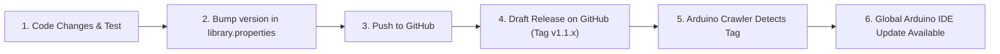

# AMK_CYD_Universal_TFT — Maintainer & Release Guide

A complete, practical reference manual for managing, updating, and releasing new versions of **AMK_CYD_Universal_TFT** to the Arduino IDE Library Manager.

---

## 📌 1. Quick Reference & Links

* **Official GitHub Repository**: [github.com/AungMoeKhine/AMK_CYD_Universal_TFT](https://github.com/AungMoeKhine/AMK_CYD_Universal_TFT)
* **Releases Management Page**: [github.com/AungMoeKhine/AMK_CYD_Universal_TFT/releases](https://github.com/AungMoeKhine/AMK_CYD_Universal_TFT/releases)
* **Arduino Library Registry PR**: [#9521](https://github.com/arduino/library-registry/pull/9521)
* **Maintainer Contact**: `Aung Moe Khine <aungmoekhine@gmail.com>`
* **Local Workspaces**:
  * Primary Arduino Library: `C:\Users\PSA\Documents\Arduino\libraries\AMK_CYD_Universal_TFT-main`
  * Desktop Working Mirror: `C:\Users\PSA\Desktop\AMK_CYD_Universal_TFT-main`

---

## 🔄 2. How the Arduino Library Update System Works

> [!NOTE]
> **No More Submission Forms or Pull Requests!**  
> Because your repository is now permanently registered in `arduino/library-registry`, Arduino's automated crawler visits your GitHub repository every **1 to 4 hours**.
>
> When the crawler detects a new Git release tag (e.g., `v1.1.2`) that is higher than the current indexed version, it automatically downloads and indexes it. Arduino IDE users worldwide will see an **"Update"** button in their Library Manager within hours.



---

## 🛠️ 3. Step-by-Step: Releasing a New Update

Follow these 4 simple steps whenever you want to release an update:

### Step 1: Update Your Code & Verify Compilation
Make your changes locally, then test compilation before publishing:
```powershell
& "C:\Users\PSA\AppData\Local\Programs\Arduino IDE\resources\app\lib\backend\resources\arduino-cli.exe" compile --fqbn esp32:esp32:jczn_2432s028r:UploadSpeed=921600,CPUFreq=240,FlashFreq=80,FlashMode=qio,FlashSize=4M,PartitionScheme=min_spiffs,DebugLevel=none,LoopCore=1,EventsCore=1,EraseFlash=none,JTAGAdapter=default,ZigbeeMode=default "C:\Users\PSA\Documents\Arduino\libraries\AMK_CYD_Universal_TFT-main\examples\QuickStart\QuickStart.ino"
```

### Step 2: Bump the Version Number
1. Open `library.properties` and increment `version`:
   ```properties
   name=AMK_CYD_Universal_TFT
   version=1.1.2
   ```
2. In `README.md`, update the release badge and add your new release notes under `## 📝 Release History & Changelog`.

### Step 3: Push Your Changes to GitHub
Upload your modified files to your GitHub repository:
`https://github.com/AungMoeKhine/AMK_CYD_Universal_TFT`

### Step 4: Publish a Release Tag on GitHub
1. Go to **Releases** → **Draft a new release**:  
   [github.com/AungMoeKhine/AMK_CYD_Universal_TFT/releases/new](https://github.com/AungMoeKhine/AMK_CYD_Universal_TFT/releases/new)
2. In **Tag**, type the new version matching `library.properties`:  
   `v1.1.2` → Click **`+ Create new tag: v1.1.2 on publish`**.
3. In **Title**, enter: `v1.1.2 - Short summary of changes`.
4. In **Description**, list the new features or bug fixes.
5. Leave **Release label** as `None` (production release).
6. Click **`Publish release`**.

*Done! Arduino's servers will pick it up automatically within a few hours.*

---

## 🔢 4. Semantic Versioning Rules (SemVer)

Always increment version numbers according to industry standard Semantic Versioning (`MAJOR.MINOR.PATCH`):

| Type | Example | When to Use |
|:---|:---:|:---|
| **PATCH** | `1.1.1` → `1.1.2` | Bug fixes, color corrections, documentation updates, or minor performance tweaks. |
| **MINOR** | `1.1.2` → `1.2.0` | Adding new features, new fonts, new example sketches, or support for a new CYD model (backward-compatible). |
| **MAJOR** | `1.2.0` → `2.0.0` | Breaking API changes (e.g. changing function names or class interfaces). |

---

## ⚠️ 5. Golden Rules for Library Manager Compliance

To ensure Arduino's automated linter never flags your repository:

> [!IMPORTANT]
> 1. **Tag Must Match `library.properties`**:  
>    If `library.properties` says `version=1.1.2`, your GitHub tag must be either `v1.1.2` or `1.1.2`. If they do not match, the Arduino indexer will skip the release.
>
> 2. **Never Delete or Overwrite an Existing Tag**:  
>    Once a release tag (like `v1.1.1`) is published, **do not delete or re-tag it**. If you made a mistake, simply make a new release with the next patch version (`v1.1.2`).
>
> 3. **Keep All Source Code Inside `src/`**:  
>    Arduino 1.5+ specification requires all `.h` and `.cpp` code to live inside `src/`. Never place loose code or duplicate `.h` files in the repository root.
>
> 4. **Example Folder Names Must Match Sketch Names**:  
>    Each example sketch must be inside a folder with the identical name:  
>    `examples/MyExample/MyExample.ino` (not `examples/MyExample/sketch.ino`).

---

## 📁 6. Repository Architecture Overview

```text
AMK_CYD_Universal_TFT/
├── library.properties          <-- Arduino metadata (name, version, maintainer)
├── LICENSE                     <-- MIT license + Third-party attribution notices
├── README.md                   <-- Documentation, tables, and setup guide
├── keywords.txt                <-- Syntax highlighting definitions for Arduino IDE
├── src/                        <-- All driver sources compiled by Arduino IDE
│   ├── AMK_CYD_Universal_TFT.h
│   ├── AMK_CYD_Universal_TFT.cpp
│   ├── AMK_CYD_LVGL.h          <-- Zero-boilerplate LVGL v8/v9 integration wrapper
│   ├── lv_conf.h               <-- Pre-configured LVGL configuration header
│   ├── AMK_TFT.h
│   ├── chipguy_CYD_resistive_display.h
│   ├── chipguy_CYD_resistive_display.cpp
│   ├── chipguy_CYD_resistive_touch.h
│   ├── chipguy_CYD_resistive_touch.cpp
│   ├── Free_Fonts.h
│   └── Fonts/
│       └── GFXFF/             <-- 48 standard vector FreeFonts
└── examples/                   <-- Standalone example sketches
    ├── QuickStart/
    │   └── QuickStart.ino
    ├── BasicTouchDemo/
    │   └── BasicTouchDemo.ino
    ├── TouchCalibration/
    │   └── TouchCalibration.ino
    ├── SpriteDemo/
    │   ├── SpriteDemo.ino
    │   └── logo_tft.h
    ├── FreeFontDemo/
    │   └── FreeFontDemo.ino
    └── LVGL_QuickStart/
        └── LVGL_QuickStart.ino <-- 1-line LVGL initialization demo
```

---

## 👥 7. Upstream Licenses & Attribution Reminder

If you ever add new code from other open-source projects, remember to keep their licenses intact:

* **`chipguyhere`**: CYD hardware auto-probing & touch bus arbitration (MIT License).
* **`Bodmer`**: Graphics primitive algorithms & `TFT_eSprite` off-screen frame buffer architecture (MIT / FreeBSD License).
* **`Adafruit Industries`**: `Adafruit_GFX` vector glyph tables and FreeFonts (BSD License).
* **`Aung Moe Khine`**: Unified library architecture, runtime detection integration, and maintainer.
