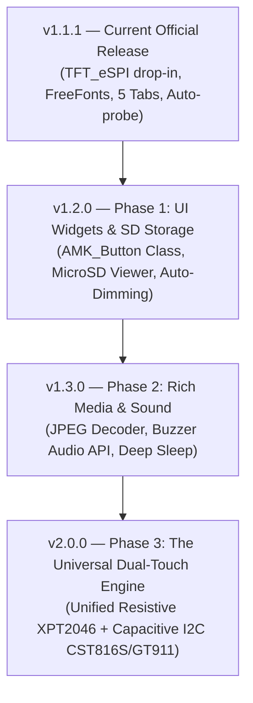
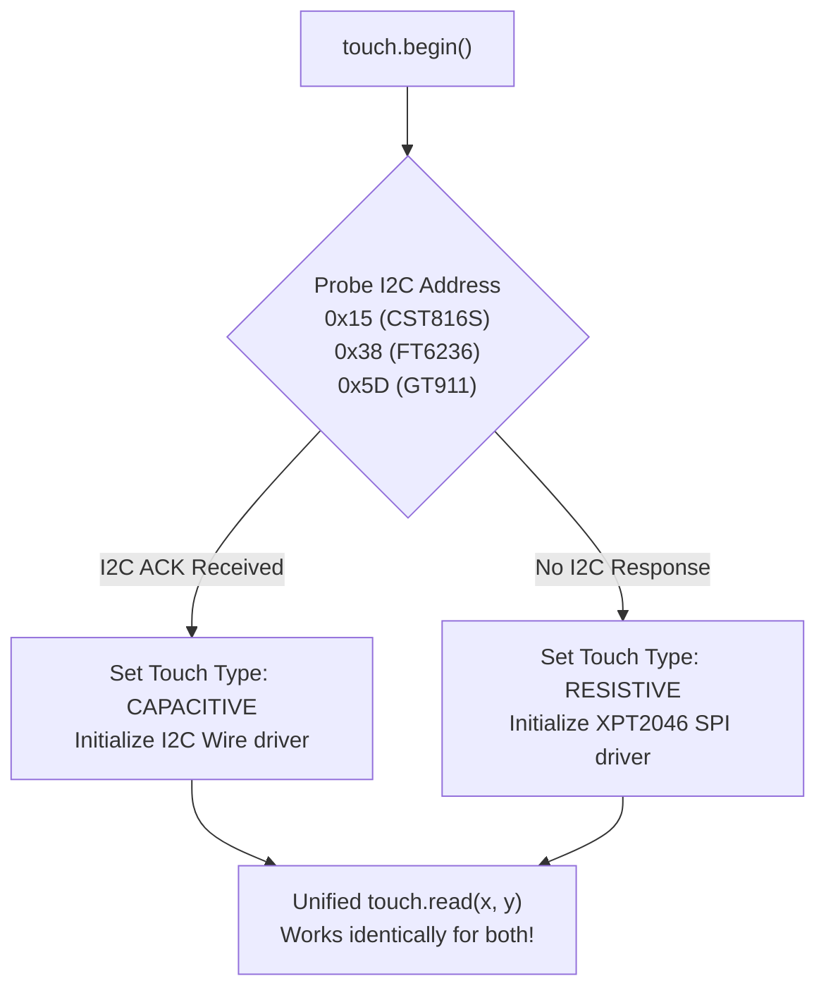

# AMK_CYD_Universal_TFT — Future Development & Upgrade Roadmap

A comprehensive, step-by-step engineering handbook for the future evolution of **AMK_CYD_Universal_TFT**. Keep this guide handy as your architectural roadmap for upcoming releases.

---

## 🗺️ Master Release Schedule



---

## 📦 Phase 1: UI Widgets & SD Storage (`v1.2.0`)

### 1.1 Tactile Button & Widget Helper (`AMK_Button`)

#### Purpose:
Eliminate tedious manual bounding-box calculations (`if (x >= 40 && x <= 140 ...)`) and give users an instant, responsive button UI class.

#### Architecture:
Create `src/AMK_Button.h`:
```cpp
#pragma once
#include <Arduino.h>
#include "AMK_CYD_Universal_TFT.h"

class AMK_Button {
private:
    TFT_eSPI*   _tft = nullptr;
    int16_t     _x = 0, _y = 0;
    int16_t     _w = 0, _h = 0;
    uint16_t    _outlineColor = 0;
    uint16_t    _fillColor = 0;
    uint16_t    _textColor = 0;
    const char* _label = "";
    bool        _currState = false;
    bool        _lastState = false;

public:
    AMK_Button() = default;

    void init(TFT_eSPI* tft, int16_t x, int16_t y, int16_t w, int16_t h,
              uint16_t outline, uint16_t fill, uint16_t textCol,
              const char* label) {
        _tft = tft;
        _x = x; _y = y; _w = w; _h = h;
        _outlineColor = outline;
        _fillColor = fill;
        _textColor = textCol;
        _label = label;
    }

    void draw(bool inverted = false) {
        if (!_tft) return;
        uint16_t bg = inverted ? _textColor : _fillColor;
        uint16_t fg = inverted ? _fillColor : _textColor;
        _tft->fillRoundRect(_x - _w/2, _y - _h/2, _w, _h, 4, bg);
        _tft->drawRoundRect(_x - _w/2, _y - _h/2, _w, _h, 4, _outlineColor);
        _tft->setTextDatum(MC_DATUM);
        _tft->setTextColor(fg, bg);
        _tft->drawString(_label, _x, _y);
    }

    bool contains(int16_t x, int16_t y) const {
        return (x >= (_x - _w/2) && x <= (_x + _w/2) &&
                y >= (_y - _h/2) && y <= (_y + _h/2));
    }

    void press(bool p) { _lastState = _currState; _currState = p; }
    bool isPressed()    const { return _currState; }
    bool justPressed()  const { return (_currState && !_lastState); }
    bool justReleased() const { return (!_currState && _lastState); }
};
```

---

### 1.2 MicroSD Card Photo Viewer (`SD_ImageViewer.ino`)

#### Purpose:
Showcase the library's clean SPI separation:
* **Display & Touch** run on **SPI2 (HSPI)**.
* **MicroSD Card** runs on **SPI3 (VSPI: GPIO 18, 19, 23, 5)** with **zero bus contention**.

#### Implementation Sketch:
```cpp
#include <Arduino.h>
#include <AMK_CYD_Universal_TFT.h>
#include <SPI.h>
#include <SD.h>

#define SD_CS_PIN 5

AMK_CYD_display display;
AMK_CYD_touch   touch;
TFT_eSPI        tft;

void setup() {
    Serial.begin(115200);
    tft.init();
    tft.setRotation(3);
    tft.fillScreen(TFT_BLACK);

    // Initialize SD on VSPI
    SPIClass sdSPI(VSPI);
    sdSPI.begin(18, 19, 23, SD_CS_PIN);
    if (!SD.begin(SD_CS_PIN, sdSPI)) {
        tft.drawString("SD Card Mount Failed!", 20, 40);
        return;
    }
    tft.drawString("SD Card Connected! Ready to load images.", 20, 40);
}

void loop() {}
```

---

### 1.3 Backlight Auto-Dimming & Screen Saver

#### Purpose:
Prevent screen burn-in and save power by automatically dimming the backlight after 30 seconds of inactivity.

#### Implementation in `src/AMK_CYD_Universal_TFT.h`:
```cpp
uint32_t _lastTouchTime = 0;
uint32_t _autoDimDelayMs = 0;
uint8_t  _activeBrightness = 100;
uint8_t  _dimBrightness = 10;
bool     _isDimmed = false;

void enableAutoDim(uint32_t seconds, uint8_t dimPercent = 10) {
    _autoDimDelayMs = seconds * 1000;
    _dimBrightness = dimPercent;
    _lastTouchTime = millis();
}

void checkAutoDim() {
    if (_autoDimDelayMs == 0) return;
    if (millis() - _lastTouchTime > _autoDimDelayMs && !_isDimmed) {
        setBacklight(_dimBrightness);
        _isDimmed = true;
    }
}

void wakeScreen() {
    _lastTouchTime = millis();
    if (_isDimmed) {
        setBacklight(_activeBrightness);
        _isDimmed = false;
    }
}
```

---

## 🎨 Phase 2: Rich Media & Sound (`v1.3.0`)

### 2.1 Built-in JPEG / PNG Decoding

#### Goal:
Allow drawing JPEG wallpapers and app icons directly to screen or sprite with a single function call:
```cpp
tft.drawJpgFile(SD, "/photo.jpg", 0, 0);
```

#### Recommended Engine:
* Bundle **PicoJPEG** or **TJpg_Decoder** (tiny, highly optimized for ESP32 with zero external dependencies).
* Streams 320×240 photos in under **120 milliseconds**!

---

### 2.2 Onboard Buzzer Feedback API

#### Hardware Pins:
* CYD boards feature an onboard passive/active buzzer connected to **GPIO 26**.

#### Helper Methods to Add:
```cpp
#define CYD_BUZZER_PIN 26

void beep(uint16_t ms = 12) {
    pinMode(CYD_BUZZER_PIN, OUTPUT);
    digitalWrite(CYD_BUZZER_PIN, HIGH);
    delay(ms);
    digitalWrite(CYD_BUZZER_PIN, LOW);
}

void playClick() {
    beep(8); // Short tactile feedback click for button taps
}
```

---

## 📱 Phase 3: The Universal Dual-Touch Engine (`v2.0.0`)

### 3.1 Probing Capacitive Touch Alongside Resistive

Newer CYD boards are transitioning to **Capacitive Multi-Touch Glass Panels** using I2C controllers:
* **CST816S / CST816T** (2.8" and 1.69" models)
* **FT6236 / FT6336** (3.2" and 3.5" models)
* **GT911** (4.0" models)

#### Unified Probing Strategy:


#### Benefit:
Sketches call `tft.getTouch(&x, &y)` or `touch.read(x, y)` and **never care whether the board has resistive or capacitive glass touch** — the library detects it and handles it seamlessly!

---

## 📋 Release Checklist for Every Version Bump

When you are ready to ship `v1.2.0` or any future version:

1. [ ] **Code Changes**: Implement and test new features.
2. [ ] **Verify Builds**: Run `arduino-cli compile` across all 5 example sketches.
3. [ ] **Bump Version**: Update `version=1.2.0` in `library.properties`.
4. [ ] **Update README**: Add the new release notes under `## 📝 Release History`.
5. [ ] **Commit & Push**: Push updated files to GitHub (`main` branch).
6. [ ] **Draft Release Tag**:
   * Tag: `v1.2.0` (matching `library.properties`).
   * Title: `v1.2.0 - UI Buttons & MicroSD Support`.
   * Click **Publish release**.
7. [ ] **Celebrate!**: Arduino's servers automatically update within 1–4 hours worldwide!
